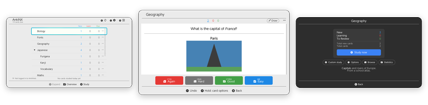

<p align="center">
  
</p>

<h1 align="center">AnkiNX</h1>

<p align="center">
  <strong>Anki flashcards on your Nintendo Switch.</strong><br>
  Review your decks on the couch, on the train or on the TV, with the same scheduling and sync as Anki.
</p>

<p align="center">
  <a href="https://github.com/lukasheber/AnkiNX/releases/latest"></a>
  
  <a href="LICENSE"></a>
</p>

<p align="center">
  
</p>

<p align="center">
  <a href="#features">Features</a> ·
  <a href="#screenshots">Screenshots</a> ·
  <a href="#getting-started">Getting started</a> ·
  <a href="#controls">Controls</a> ·
  <a href="#troubleshooting">Troubleshooting</a> ·
  <a href="#building-from-source">Building</a>
</p>

---

AnkiNX is a native Switch app built on Anki's own engine. Your cards are
scheduled exactly as in Anki, look the way your note types draw them, and sync
with AnkiWeb, so you can pick up on the Switch where you left off on your
computer and the other way round.

> **Reviewing only.** AnkiNX is for studying. Create and edit your notes in
> Anki on your computer, then review them on the Switch.

## Features

<table>
  <tr>
    <td width="50%" valign="top">
      <h3>📚 Your decks</h3>
      Today's new, learning and due counts, an estimate of how long they will take, and your study streak. Each deck has an overview with custom study, deck options (FSRS or SM-2) and statistics, and a card browser.
    </td>
    <td width="50%" valign="top">
      <h3>🃏 Cards as Anki shows them</h3>
      Your note types' HTML, CSS and JavaScript, images (animated GIFs too), audio, maths and chemistry, furigana, right-to-left scripts, Thai and Hindi, custom fonts, type-in-the-answer and Image Occlusion.
    </td>
  </tr>
  <tr>
    <td valign="top">
      <h3>🔄 Sync with AnkiWeb</h3>
      Log in once and AnkiNX syncs when it opens, after you study and when you exit. A self-hosted sync server works too, and so does copying your collection to the SD card.
    </td>
    <td valign="top">
      <h3>🎮 Made for the Switch</h3>
      Answer with the shoulder buttons, play with one Joy-Con held sideways, rebind buttons, use touch and swipes in handheld mode, scribble on the whiteboard, and get larger text on a TV.
    </td>
  </tr>
  <tr>
    <td valign="top">
      <h3>🧠 Anki's scheduler</h3>
      The same answer buttons and intervals as Anki, with undo and redo, flags, marks, burying, suspending, due dates, card info and leech handling.
    </td>
    <td valign="top">
      <h3>🛟 Safe and up to date</h3>
      Backups you can restore on the console, Anki's Check Database, light and dark themes, four languages (English, Portuguese, Spanish, Japanese) and updates from inside the app.
    </td>
  </tr>
</table>

## Screenshots

<table>
  <tr>
    <td width="50%"></td>
    <td width="50%"></td>
  </tr>
  <tr>
    <td align="center"><sub><b>Deck list</b>: today's counts at a glance</sub></td>
    <td align="center"><sub><b>Deck overview</b>: in the dark theme</sub></td>
  </tr>
  <tr>
    <td></td>
    <td></td>
  </tr>
  <tr>
    <td align="center"><sub><b>Reviewing</b>: answer with ZL, L, R or ZR</sub></td>
    <td align="center"><sub><b>Maths</b>: typeset from LaTeX, as in Anki</sub></td>
  </tr>
  <tr>
    <td></td>
    <td></td>
  </tr>
  <tr>
    <td align="center"><sub><b>Right-to-left scripts</b>: Persian, Arabic and Hebrew</sub></td>
    <td align="center"><sub><b>Image Occlusion</b>: masks you can toggle with X</sub></td>
  </tr>
</table>

## Getting started

### 1. Install

1. Download **`AnkiNX.nro`** from the [latest release](https://github.com/lukasheber/AnkiNX/releases/latest).
2. Copy it to the `/switch/` folder on your SD card.
3. Start it from the Homebrew Menu.

> [!TIP]
> Open the Homebrew Menu by holding **R** while starting a game, rather than
> from the Album. AnkiNX then has the console's full memory, which large
> collections and media need.

Later versions install themselves: AnkiNX tells you when an update is
available, and **Settings › About › Updates** downloads it.

### 2. Bring your cards

**With AnkiWeb (recommended).** Press **−** for Settings, open
**Account & sync** and log in, then press **X** to sync. From then on AnkiNX
syncs automatically, and your reviews reach Anki on your other devices.

<details>
<summary><b>Without AnkiWeb: copy your collection to the SD card</b></summary>
<br>

1. Close Anki on your computer, so all changes are saved.
2. From your Anki profile folder, copy `collection.anki2` and the
   `collection.media` folder to `/switch/ankinx/` on the SD card. The profile
   folder is `Anki2/<profile name>` inside `%APPDATA%` on Windows,
   `~/Library/Application Support` on macOS and `~/.local/share` on Linux.
3. Start AnkiNX.

To take your reviews back to the computer, copy `collection.anki2` back the
same way, with Anki closed. This replaces the computer's copy, so don't study
on both between copies.

</details>

## Controls

| On the deck list | |
| --- | --- |
| **A** | Study the highlighted deck |
| **R** | Deck overview: custom study, options, browse, statistics |
| **Y** | Expand or collapse subdecks |
| **X** | Sync |
| **−** / **+** | Settings / Exit |

| While reviewing | |
| --- | --- |
| **A** | Show the answer, then *Good* |
| **ZL** · **L** · **R** · **ZR** | Again · Hard · Good · Easy |
| **−** | Undo |
| **X** | Show hints (toggle masks on Image Occlusion cards) |
| **Y** | Replay audio; hold for card options (flag, bury, suspend, card info…) |
| **L3** / **R3** (stick press) | Zoom out / zoom in |
| **B** | Back to the decks |

Touch works everywhere: tap the card to show the answer, tap the answer
buttons, and tap links, buttons and fields inside your cards. Buttons can be
changed in **Settings › Controls**.

## Troubleshooting

AnkiNX keeps a log at `/switch/ankinx/ankinx.log` on the SD card; the previous
run's is `ankinx.old.log`, which is the one to look at after a crash. Crash
reports from Atmosphère are in `/atmosphere/crash_reports/`. Please attach both
when you [open an issue](https://github.com/lukasheber/AnkiNX/issues).

Your collection, media and backups live in `/switch/ankinx/`.

## Building from source

<details>
<summary>Requirements, build steps and repository layout</summary>
<br>

You need Linux or WSL2 with devkitPro (devkitA64, libnx and the switch-*
portlibs), a pinned Rust nightly and Python 3.13. `tools/provision_phase1.sh`
sets these up. Then:

```sh
bash tools/fetch_frontend_deps.sh   # borealis, litehtml, lunasvg, QuickJS at pinned commits
bash tools/fetch_ftl.sh             # Anki's translations
bash switch/tools/vendor.sh apply   # patched crates from switch/patches/
bash switch/build_core.sh           # Anki's Rust backend -> switch/dist/libanki_switch_core.a
bash app/build.sh                   # the app -> app/dist/AnkiNX.nro
```

Anki's source (26.09.3) is expected, unmodified, in
`source_code/anki-26.09.3`. `bash switch/test_core_host.sh` runs the backend's
tests on Linux, including under an emulation of the Switch's filesystem rules.

| Path | Contents |
| --- | --- |
| [`app/`](app/README.md) | The Switch app: borealis interface, litehtml card renderer, card JavaScript, audio. Plans in [app/ROADMAP.md](app/ROADMAP.md) |
| [`switch/`](switch/README.md) | Anki's Rust backend cross-compiled for the Switch: the `anki_switch_core` crate, patches and target files |
| `tools/` | Environment setup, dependency fetchers and helper scripts |
| `test-deck/` | A deck with every card type and template feature, each card saying what to check |
| `VERSION`, [`CHANGELOG.md`](CHANGELOG.md) | Version and release notes |

</details>

## Licence

AnkiNX is free software under the
[GNU Affero General Public License, version 3 or later](LICENSE), the same
licence as Anki, whose backend it includes. If you distribute the `.nro`, you
must also offer its source code.

<details>
<summary>Third-party components</summary>
<br>

| Component | Licence |
| --- | --- |
| Anki (`source_code/`, rslib) | AGPL-3.0-or-later, with BSD-3 portions |
| borealis (interface framework) | Apache-2.0 |
| litehtml (HTML/CSS layout; our changes in `app/patches/litehtml`) | BSD-3-Clause |
| gumbo (HTML parser, bundled with litehtml) | Apache-2.0 |
| QuickJS-ng (card JavaScript) | MIT |
| Card page runtime (`app/resources/script/runtime.js`, built from `app/js`; licence texts in `runtime-licenses.txt`): linkedom, uhyphen, boolbase | ISC |
| … htmlparser2, dom-serializer, cssom, html-escaper, jQuery | MIT |
| … css-select, css-what, domhandler, domutils, domelementtype, entities, nth-check | BSD-2-Clause |
| lunasvg (SVG) | MIT |
| DejaVu Sans, Sans Mono and Serif fonts (`app/resources/card_fonts`) | Bitstream Vera licence; DejaVu changes public domain |
| Noto Sans Thai and Noto Sans Devanagari fonts (`app/resources/card_fonts`; `LICENSE-Noto.txt`) | SIL Open Font License 1.1 |
| Material Icons font (`app/resources/material`) | Apache-2.0 |
| Patched crates (`switch/patches/`): libc, getrandom | MIT OR Apache-2.0 |
| Patched crates: mio, tokio | MIT |
| Patched crate: ring | Apache-2.0 AND ISC |
| Patched crate: stacker | MIT OR Apache-2.0 |
| Typst (maths layout), MiTeX (LaTeX to Typst; `switch/anki_switch_core/assets/mitex`) | Apache-2.0 |
| New Computer Modern fonts (`switch/anki_switch_core/assets/fonts`) | GUST Font License (maths); GPL-3.0+ with font exception (text) |

The Switch system fonts used by the desktop preview are Nintendo's and are not
part of this repository; `tools/fetch_frontend_deps.sh` copies them from
borealis.

</details>

---

<p align="center">
  <sub>AnkiNX is an unofficial project, not affiliated with or endorsed by Ankitects or Nintendo.<br>
  Anki is a trademark of Ankitects Pty Ltd. Nintendo Switch is a trademark of Nintendo.</sub>
</p>
