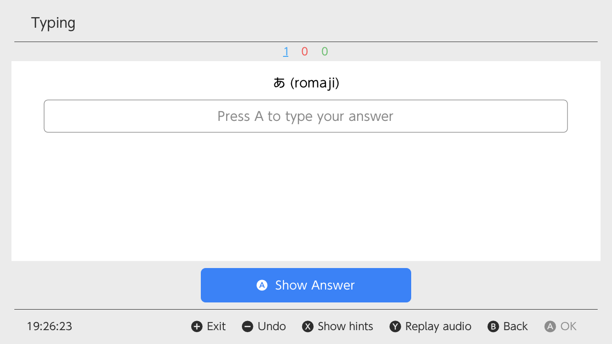

# AnkiNX

Anki for the Nintendo Switch (homebrew). A native app, not an Android
wrapper, built on Anki's own Rust backend, so scheduling, card rendering and
AnkiWeb sync behave as in Anki desktop. The interface follows AnkiDroid.

Unofficial: not affiliated with Ankitects, AnkiDroid or Nintendo.

| | |
| --- | --- |
|  |  |
|  |  |
|  |  |

## Scope: reviewing on the go

AnkiNX is for **studying**: deck list, reviews, answer buttons, undo, audio,
images, type-in-the-answer and Image Occlusion cards. Adding and editing notes
and cards is **not implemented**. Create and maintain your collection in Anki
desktop or AnkiDroid, and use AnkiNX to review it.

**With AnkiWeb (recommended).** Log in with the − button and sync with X.
Automatic sync is on by default: when the app opens, after studying and before
exiting with +. Your reviews then reach Anki desktop and AnkiDroid, and new
cards made there reach the Switch.

**Offline.** Without AnkiWeb, copy the collection to the SD card:

1. Close Anki desktop, so all changes are written to the collection file.
2. From your Anki profile folder, copy `collection.anki2` and the
   `collection.media` folder to `/switch/ankinx/` on the SD card, replacing
   what is there. The profile folder is `Anki2/<profile name>` inside
   `%APPDATA%` on Windows, `~/Library/Application Support` on macOS and
   `~/.local/share` on Linux.
3. Start AnkiNX.

To bring your Switch reviews back to the computer, copy `collection.anki2`
back the same way, with Anki closed. This replaces the computer's copy, so
don't study on both sides between copies.

## Layout

| Path | What |
| --- | --- |
| `app/` | The Switch app: borealis UI, litehtml card renderer, audio. See [app/README.md](app/README.md) and [app/ROADMAP.md](app/ROADMAP.md) |
| `switch/` | Anki's Rust backend cross-compiled for Horizon: the `anki_switch_core` crate (JSON API, SQLite VFS, POSIX shim), Rust std/libc patches, target spec. See [switch/README.md](switch/README.md) |
| `tools/` | Environment setup, source sync into WSL, dependency fetchers, icon tool |
| `VERSION`, `CHANGELOG.md` | Project version and release notes |

## Building

Linux or WSL2 with devkitPro (devkitA64, libnx, switch-* portlibs), a pinned
Rust nightly and Python 3.13. `tools/provision_phase1.sh` sets this up. Then:

```sh
bash tools/fetch_frontend_deps.sh   # borealis, litehtml, lunasvg at pinned commits
bash tools/fetch_ftl.sh             # Anki translations
bash switch/tools/vendor.sh apply   # patched crates from switch/patches/
bash switch/build_core.sh           # Rust backend -> switch/dist/libanki_switch_core.a
bash app/build.sh                   # -> app/dist/AnkiNX.nro
```

Anki's source (26.09.3) is expected in `source_code/anki-26.09.3`, unmodified.
`bash switch/test_core_host.sh` runs the backend tests on Linux, including
under an emulation of the Switch's filesystem rules.

## Licence

AnkiNX is free software under the GNU Affero General Public License, version
3 or later (AGPL-3.0-or-later), the same licence as Anki, whose backend it
includes. See [LICENSE](LICENSE). If you distribute the `.nro`, you must also
offer its source code.

Third-party code and assets, under their own licences:

| Component | Licence |
| --- | --- |
| Anki (`source_code/`, rslib) | AGPL-3.0-or-later, with BSD-3 portions |
| borealis (UI framework) | Apache-2.0 |
| litehtml (HTML/CSS layout) | BSD-3-Clause |
| lunasvg (SVG) | MIT |
| Material Icons font (`app/resources/material`) | Apache-2.0 |
| Patched crates (`switch/patches/`): libc, getrandom | MIT OR Apache-2.0 |
| Patched crates: mio, tokio | MIT |
| Patched crate: ring | Apache-2.0 AND ISC |
| Patched crate: stacker | MIT OR Apache-2.0 |
| Typst (maths layout), MiTeX (LaTeX to Typst; definitions in `switch/anki_switch_core/assets/mitex`) | Apache-2.0 |
| New Computer Modern fonts (`switch/anki_switch_core/assets/fonts`) | GUST Font License (maths); GPL-3.0+ with font exception (text) |

The Switch system fonts used by the desktop preview are Nintendo's. They are
not part of this repository: `tools/fetch_frontend_deps.sh` copies them from
borealis. The app logo depicts Joy-Con-style controllers. AnkiNX is not
affiliated with or endorsed by Nintendo.

## Installing

Copy `AnkiNX.nro` to `/switch/` on the SD card and start it from the
Homebrew Menu. For full memory, open the Homebrew Menu by holding R while
starting a game rather than from the Album. Data lives in `/switch/ankinx/`.
